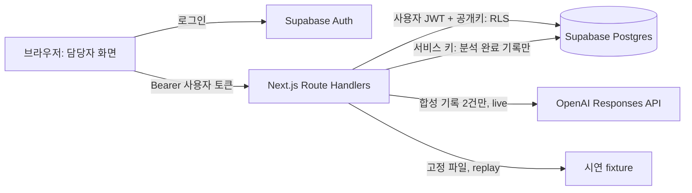

# 아키텍처 — 한 웹 앱으로 완주

## 기술 선택

Node.js ≥22.12 (24 LTS 권장), Next.js App Router 16.x, React 19.x, TypeScript 5.9.x, Supabase Auth/Postgres 및 `@supabase/supabase-js` 2.x, Zod 4.x, Vitest 5.x, Playwright 1.x. 정확한 버전은 `package.json` / `package-lock.json`을 따른다. 공식 기술 링크·모델 접근 한계는 [SOURCES.md](SOURCES.md). 별도 ORM, 벡터 DB, 큐, 마이크로서비스, 공공 API는 MVP에 없다.

## 신뢰 경계

1. 브라우저는 Supabase 공개키로 Auth 이메일·암호 로그인을 수행하고 사용자 access token을 메모리에 둔다. refresh는 Supabase 클라이언트가 메모리 세션으로 처리하며, React `accessToken`은 `onAuthStateChange`(TOKEN_REFRESHED 등)로 동기화한다. 새로고침 시 세션은 사라지고 다시 로그인한다. `persistSession:false`, `autoRefreshToken:true`, `detectSessionInUrl:false`. 사전 생성 계정만 사용, 공개 회원가입 비활성화. 서버/브라우저 키 혼합 금지.
2. 모든 `/api/*`는 `Authorization: Bearer <access_token>`을 받는다. 서버는 Supabase Auth의 `getUser(token)`으로 매 요청 사용자 확인 후, **해당 토큰이 설정된 별도 사용자 클라이언트**로 일반 DB 작업을 수행한다. 비인증 요청은 401. API 요청이 가진 owner_id를 신뢰하지 않는다.
3. 사례, 기록, 검토 및 조회는 RLS가 소유자를 강제한다. 분석 예약은 인증 사용자의 `start_analysis` SQL 함수가 `auth.uid()`를 사용한다. 서버의 service role 키는 RLS를 우회하므로 **서버에서 사용자 토큰 검증과 사용자 클라이언트로 소유권 확인 후** 해당 분석의 `processing` 행을 조건부 완료/실패로 바꾸는 용도로만 사용한다. 브라우저에 서비스 키 금지.
4. 인용은 서버가 두 기록 ID와 실제 원문에 대해 검증하고, 사업 후보는 서버가 로컬 DB 목록과 규칙으로 산출한다. 하나라도 허용 불가이면 결과 전체를 실패 처리한다. AI 출력은 HTML이 아니라 문자열로 렌더링한다.

## 분석 시퀀스

1. API가 인증, 사례 접근 확인, 멱등키·입력 검증 후 `start_analysis(case_id, key, mode)`를 호출한다. DB 함수는 동일 키 재사용, 처리 중 중복, 기록 2건, 한도, 오래된 처리 정리를 트랜잭션 내에서 확인하고 처리 중 행을 예약한다.
2. 새 예약만 서버에서 두 기록·사례·사업 목록을 다시 읽는다(준비 조회). 예약 시각부터 **전체 벽시계 45초**(`ANALYSIS_OVERALL_TIMEOUT_MS`) 안에 준비 조회·엔진·성공 저장을 끝내며, 초과 시 `TIMEOUT`으로 실패 저장한다. `live`: Responses API REST를 호출하고 `output` 배열에서 message `output_text`를 추출한다(reasoning 선행 가능). 호출당 20초, 일시적 429/5xx/네트워크만 최대 1회 재시도. 실패 시 replay로 자동 전환하지 않는다. `replay`: 고정된 두 문장과 날짜가 정확히 맞는 사례에 한해 fixture를 읽고 현재 기록 ID로 치환한다.
3. 결과 형태·4개 범주·인용·내용 제한을 검증하고, 검증된 분석과 후보를 한 JSON으로 묶어 분석 행의 `status=processing`일 때만 `succeeded`로 갱신한다. 만료 등으로 이미 상태가 바뀐 행은 결과를 버린다.
4. 준비 조회·엔진·성공 저장 실패는 `failed`와 오류 코드로 정리한다. 실패 행조차 저장할 수 없으면 `SERVICE_UNAVAILABLE`과 `recovery` 힌트를 반환한다. 클라이언트는 실패 시 새 멱등키로 다시 시도할 수 있다. 동일 키를 재전송하면 기존 상태를 반환하므로 추가 비용이 생기지 않는다.
5. 서버가 중간에 종료되어 갱신하지 못하면 60초가 지난 행은 **같은 사례의 다음 분석 시작 시** failed/TIMEOUT으로 정리한다. 조회만 하는 경우에는 계속 processing일 수 있어 화면은 60초가 넘으면 새 요청을 안내한다.

## 데이터와 화면 경계

- 인증: 이메일/암호는 Supabase Auth로만 처리. 사례 데이터: `cases`, `consultations`. 결과: `analyses.result` JSON 스냅샷 및 `reviews`. 공통 목록: `welfare_programs`.
- `analyses`는 이전/현재 기록의 FK를 저장하여 어떤 원문을 분석했는지 추적한다. 이 MVP는 기록 수정/삭제를 제공하지 않는다.
- 사업 내용도 결과 생성 시 스냅샷에 넣는다. 나중에 원본 사업 목록을 고쳐도 이전 분석의 출처/검토 항목은 유지한다.
- API만으로 화면 기능을 구현한다. 사용자가 직접 Supabase REST에 접근하는 우회도 RLS가 제한하지만, API 입력 검증은 우회할 수 있으므로 이 데모 프로젝트를 실제 민감정보에 사용하지 않는다.

## 주요 디렉터리

`app/`(로그인·사례·API Route Handlers), `lib/auth`, `lib/db`, `lib/analysis`, `lib/matching`, `components/`, `fixtures/`, `schemas/`, `sql/`, `e2e/`. UI는 fetch에 bearer를 붙이고 모든 입력을 서버에서도 검증한다.

## 무박 2일 계획 — 총 24시간 예시

| 경과 | 책임(3~4명) | 완료 기준 |
|---|---|---|
| 0~2h | 전원: 범위·계정·기술 동결 | 배포/키/공식 출처 확인, 입력·응답 계약 공유 |
| 2~6h | A 인증/DB, B 화면, C AI/매칭, D 기획·시드·테스트 | DB 격리와 목록 화면, 고정 케이스 준비 |
| 6~12h | A API, B 상세·입력, C 분석 검증·매칭, D 테스트 | replay 전 구간 동작 |
| 12~17h | A/C live 결합, B 결과·오류, D 시나리오 점검 | live 정상 1회 및 오류 분기 |
| 17~21h | 전원 통합·권한·근거 검증 | P0 테스트, 모델/공공 출처 재확인 |
| 21~24h | 시연자 리허설, 다른 인원 장애 대안 | 3회 연속 리허설·녹화 |

2명인 경우 A가 DB/API/AI, B가 화면/시드/시연을 맡고 12시간 시점에 replay를 완성한다. 시연 3시간 전 기능 동결, 1시간 전 live 실패 시 replay로 전환한다.
